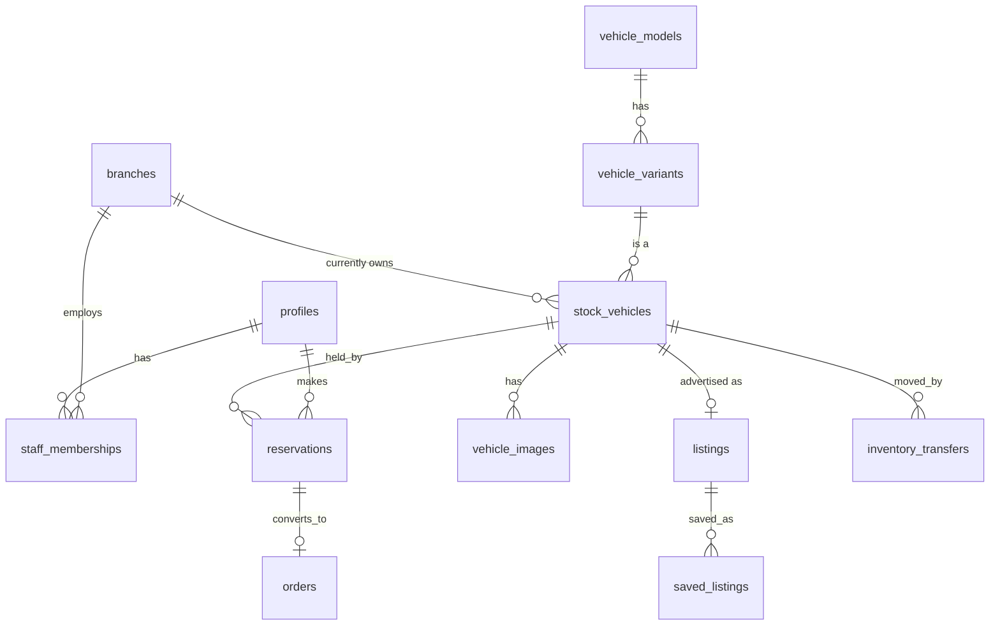

# Database

PostgreSQL, managed with Prisma (`packages/database/prisma/schema.prisma`). Tables are snake_case (`@@map`), columns camelCase, money is
**integer pence**.

## Models

`profiles` · `branches` · `staff_memberships` · `vehicle_models` · `vehicle_variants` · `stock_vehicles` ·
`vehicle_images` · `listings` · `saved_listings` · `enquiries` · `test_drives` · `reservations` · `orders` ·
`inventory_transfers` · `audit_events` · `outbox_events`



`profiles.id` equals the Supabase Auth user id (the JWT `sub`). A profile row is created on first sign-in
with role `CUSTOMER`.

## Roles are stored, never claimed

- `profiles.role` holds only **global** roles: `CUSTOMER`, `HEAD_OFFICE_ADMIN`, `SUPER_ADMIN`.
- `staff_memberships(profileId, branchId, role)` holds **branch** roles: `SALES_EXECUTIVE`, `BRANCH_MANAGER`.
- The API reads these on every request. Nothing in a token or request body can grant a role or a branch.

## Business rules and where each is enforced

| # | Rule | Enforcement |
|---|---|---|
| 1 | Unique VIN where applicable | `stock_vehicles.vin` unique (nullable; Postgres allows many NULLs). Contract rejects malformed VINs (17 chars, no I/O/Q). |
| 2 | Every vehicle has a current owning branch | `stock_vehicles.branchId` NOT NULL, FK `ON DELETE RESTRICT`. |
| 3 | Branch staff modify only their branches | `access-policy.ts`, called in every service; covered by `access.int-spec.ts`. |
| 4 | Head office manages all branches | `branchAccess: 'all'` for `HEAD_OFFICE_ADMIN` / `SUPER_ADMIN`. |
| 5 | No double reservation | (a) `SELECT … FOR UPDATE` on the vehicle serialises buyers, (b) partial unique index `reservations_one_active_per_vehicle`, (c) idempotency key. Tested with 20 concurrent buyers: exactly one wins. |
| 6 | Price snapshots | `reservations.pricePence` and `orders.agreedPricePence` are copied from the locked row and protected by `BEFORE UPDATE` triggers that reject changes. |
| 7 | Transfers update ownership atomically | `TransfersService.complete` changes `stock_vehicles.branchId`/`status` and the transfer in one transaction under the vehicle lock. Check constraint `fromBranchId <> toBranchId`; only one `REQUESTED` transfer per vehicle (partial unique index). |
| 8 | History is preserved | All FKs are `RESTRICT` (no cascading deletes of sales history). `audit_events` is append-only (trigger rejects UPDATE/DELETE). Orders/reservations are status-driven, never deleted. |
| 9 | Indexes/constraints/FKs | See `schema.prisma` (`@@index` on every foreign key and common filter) and the `integrity_guards` migration. |

### Vehicle status lifecycle

```text
AVAILABLE ─reserve─► RESERVED ─order completed─► SOLD
    │  ▲                 │
    │  └─cancel/expire───┘
    ├─request transfer─► IN_TRANSIT ─complete─► AVAILABLE (at new branch)
    └─manual─► WITHDRAWN ─manual─► AVAILABLE
```

Expired holds are released lazily (the next buyer's request) **and** by a 60-second sweeper
(`ReservationExpiryJob`), safe across multiple API instances (`FOR UPDATE SKIP LOCKED`).

## Migrations

Two migrations under `packages/database/prisma/migrations`:

1. `…_init`: generated by Prisma from `schema.prisma`.
2. `…_integrity_guards`: hand-written SQL for what Prisma cannot express (partial unique indexes, check
   constraints, triggers).

Workflow:

```bash
pnpm db:migrate          # create + apply a migration in development (prisma migrate dev)
pnpm db:deploy           # apply pending migrations (CI / production)
pnpm db:seed             # development reference data (refuses to run when NODE_ENV=production)
```

After editing `schema.prisma`, run `pnpm db:migrate`, then re-check that the guards migration still applies.

### Timestamps

Prisma `DateTime` maps to `timestamp(3)` **without** time zone, stored as UTC. In raw SQL never compare these columns with
`now()` (it is interpreted in the session time zone); bind a JS `Date` instead (see
`ReservationsRepository.lapsedVehicleIds`).

## Transactional outbox

`outbox_events` is written in the same transaction as the change (reservation created, order status, transfer
completed, enquiry created, test drive requested). `OutboxDispatcher` polls and calls registered handlers. **No
email/SMS provider is wired yet**: with no handler registered, events are logged and marked processed. Register
handlers with `dispatcher.register(type, fn)` when a provider is chosen.
